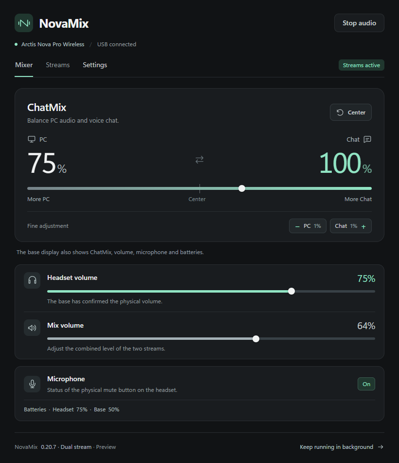

# NovaMix for Windows

NovaMix is an open-source ChatMix controller for the **SteelSeries Arctis Nova Pro Wireless**. Balance PC audio and chat apps from the headset wheel or the desktop mixer. NovaMix mixes two audio streams and leaves each app’s own Windows volume where you set it.



## Download

Download **[NovaMix Setup for Windows x64](https://github.com/flavio92fs/NovaMix/releases/latest/download/NovaMix-Setup-x64.exe)**. The [latest release](https://github.com/flavio92fs/NovaMix/releases/latest) includes release notes and the [SHA-256 checksum](https://github.com/flavio92fs/NovaMix/releases/latest/download/NovaMix-Setup-x64.exe.sha256).

**Requirements:** Windows 11 x64, an Arctis Nova Pro Wireless base connected by USB for hardware controls, and two distinct Windows playback endpoints to use as input streams. The included wizard is designed for one standard VB-CABLE endpoint and an unused digital output, such as S/PDIF. If your PC has no usable spare digital output, supply another distinct virtual playback endpoint and choose it in **Streams**. The final playback output must be a third endpoint.

The NovaMix installer is unsigned, so Windows SmartScreen may prompt you. The optional VB-CABLE driver runs through VB-Audio’s own installer and requires administrator approval. To verify the download, run `Get-FileHash .\NovaMix-Setup-x64.exe -Algorithm SHA256` in PowerShell and compare the result with the checksum file.

## Install and route audio

1. Connect the base by USB. Quit any running NovaMix instance from its tray icon before upgrading. Close any running Audio Setup window as well.
2. Run **NovaMix Setup**. Leave the VB-CABLE option enabled if you need it, then follow the vendor setup. Restart Windows when the driver is newly installed.
3. Open **NovaMix Audio Setup** from the Start menu. On Italian systems it may appear as **Configura audio NovaMix**. Select three different endpoints.

   | Field | What to select |
   | --- | --- |
   | **PC stream** | An unused digital output or a separate virtual playback endpoint. Leave the physical digital port unplugged if you use it for this stream. |
   | **Chat stream** | **CABLE Input**, the standard VB-CABLE playback endpoint, or **NovaMix Chat** if already renamed. |
   | **Play through** | **Headphones (Arctis Nova Pro Wireless)**, or the device where you want to hear the combined mix. |

4. Optionally rename the stream endpoints **NovaMix PC** and **NovaMix Chat**. The wizard can also hide or restore the optional **CABLE In 16ch** endpoint. Select **Save and open NovaMix**, then **Start audio**. If the wizard cannot select one of your virtual endpoints, open NovaMix from Start and configure all three endpoints in its **Streams** tab.
5. In **Windows Settings → System → Sound**, set the **PC stream** as your default output. In **Sound → Volume mixer**, set the output for Discord, WhatsApp, Telegram, or any other chat app to the **Chat stream**. If an app has its own audio output setting, select the same Chat endpoint there. Keep your headset microphone selected as the app’s input.
6. Play something from each group and check the PC and Chat meters in **Streams**. Press the headset wheel to enter ChatMix, then turn it. You can also use the on-screen slider or the **1%** buttons.

You can use a different playback device, such as Bluetooth speakers. Select **Stop audio**, choose the device in **Streams**, and restart the mixer. To return to direct playback when NovaMix is closed, select your physical output as the Windows default and reset any chat apps that still point to VB-CABLE.

## Controls and system tray

- **ChatMix** balances PC and Chat. At the center, both streams are at full level. The mix volume adjusts the combined output.
- **Headset volume** adjusts the base’s physical volume. **Use keyboard volume controls** lets compatible media keys or wheels adjust that physical level. The base may show its own temporary volume pop-up.
- **System tray** shows hardware microphone mute and headset battery status. Enable **Show battery level as digits** for compact Segoe UI numbers. Use **Battery number background** to switch between a colored background with white digits and transparent icons with colored digits. The three battery colors follow your low and medium thresholds. **Number size** adjusts the font from 8 to 16 pixels at 100% scaling, with 12 pixels as the default. Hover to see the full percentage. You can configure three colors, both thresholds and an optional low-battery notification. Pin the icons in Windows taskbar settings if they appear in the overflow menu.
- **Base display** can show ChatMix, physical volume, hardware mute and battery readings. Those readings use the levels reported by the headset and base. Turning the display option off restores the base’s own menus.
- **Settings → Language / Lingua** switches between **English** and **Italiano** and saves your preference. Windows display language determines the default. Closing the panel keeps the mixer running. Use **Quit** in the tray menu to stop it.

## Troubleshooting and privacy

- **No audio:** Check all three endpoints and the signal meters. If an app is routed directly to the headset, it bypasses the mixer. Restart the app if it keeps playing through its previous endpoint.
- **An endpoint changed or disappeared:** Reconnect the device, select **Stop audio** if needed, and choose the new endpoint in **Streams**. Windows can assign a new device ID after a driver reinstall or USB configuration change. Renaming an existing endpoint is fine.
- **Headset controls or battery missing:** Verify that the USB base is connected and that another utility is not taking control of it. Other Arctis models and unverified USB variants may have different hardware controls.
- **Diagnostics:** Export a local report from **Settings**. Review device identifiers, endpoint names and USB traces before posting it publicly.
- **Local connection:** Electron talks to the native mixer at `127.0.0.1`. Windows assigns a free port on each launch and NovaMix passes the current address and a session token to the panel. Your router, LAN IP and GitHub URL are independent of this connection.

## Build from source

Install **Visual Studio Build Tools** with the **Desktop development with C++** workload and a Windows 11 SDK. Open Windows PowerShell in this repository and run:

```powershell
.\build-release.ps1
```

The script builds the native engine, prepares the pinned Electron Windows x64 runtime, verifies the dependency archives and produces the installer and checksum in `dist\`. For offline builds, pass the original ZIPs with `-ElectronArchive` and `-CableArchive`. For a local development run, use `.\build.ps1`, then `.\build-ui.ps1`, then start `.\NovaMix.exe`. Node.js is only needed if you run the optional Electron shell test.

The audio engine uses native WASAPI loopback and Windows USB HID. Electron provides the desktop panel. The project source is [MIT-licensed](LICENSE). See [third-party notices](THIRD-PARTY.md), the [changelog](CHANGELOG.md), and the [release checklist](RELEASING.md).

NovaMix is an independent project. SteelSeries and Arctis are trademarks of their respective owners.
